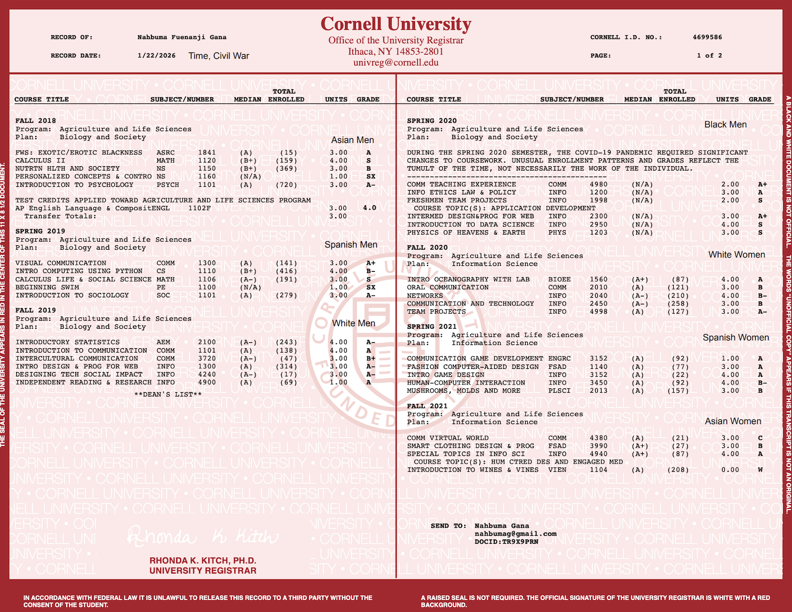
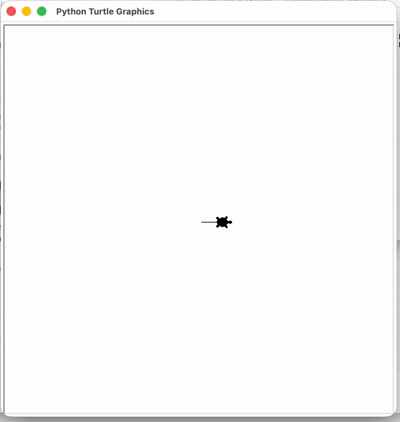

# Recursive Spiral 

This project uses Python's built-in **turtle graphics** module to draw a colorful spiral pattern.  
It's a simple but cool way to explore loops, geometry, and visual creativity with with Python.
  Black: Cursor   
  Red: Tree    
  Blue: Leaf   
  Blue and Green Switched Around For Tree and Leaf As Numpy Otherwise Green Then Blue and Numbers are As is Such as Money   
  Apple Fruits Supplements for Any RBG, and the Perfectly Placed RGB is Cornell University School of Agriculture Information Science 
  Cornell University School of Agriculture and Life Sciences Does Not Have a Computer Science Program  
  Green: Marijuana   
  Known: Complex Body, Complex Body Where Anything on The Far End of Marijuana is a Complex Body   
  Lemon Cut Into is Still Circle Seen In Another Dimensions Where Fruits Are Accessed By the Knowledge of Color   
  On Two Far Ends Where Astrology is Seen as the Definite 3 Making a 12, Twins Are All Pulley Lever Systems   
  A Color Match is Really A Stripe By Any Connotation of Money Where You Pay For the Goods You Have By Reading a Banner   
  Green is Marijuana Alone   
  Design Implication is Lighting Principle, Sun Babylonian Fall   
  Four Akashic Touch Builds, Pads From Women, Farm Work, Da Vinci Rig For Personalities, Days of The Week, Homework, RGB Code, Jobs, Red White and Blue, Cornell University Official Transcript, Grades By Race, 144 Where Grades are Listed For Preview For Minis  
  Trigger Warning, Extreme Virtual Reality, Homosexuality, LGBT+  

## Preview
Running the script will generate a spiral made up of repeating shapes and colors from the classic RGB values similar to digital art created by a spirograph.

